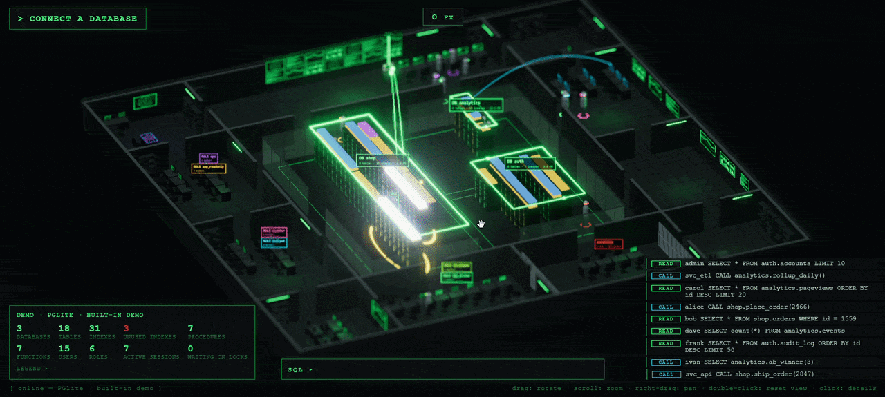

<h1 align="center">3DDB</h1>

<p align="center"><b>A database as a living 3D datacenter.</b><br>
Every query is a pulse. Every table is a rack. Every user walks the floor.</p>

<p align="center"><a href="https://vincenzomanto.github.io/3DDB/"><b>Try it live in your browser →</b></a></p>

<p align="center">
  
</p>

```bash
npx 3ddb --type demo
```

One command. No install, no signup, no config. A browser tab opens and your database is alive.

PostgreSQL, MySQL / MariaDB, SQL Server and MongoDB. Read-only: 3DDB never writes to your database.

---

## Why

A database is the busiest place in your stack and the one you can't see. You get a wall of numbers, a slow-query log and a hunch.

3DDB turns the catalog and the profiler into a place you can look at. Hot tables glow. Locks turn red. An index nobody uses goes grey. A runaway query shows up as a crowd running to one rack. You understand the state of the system in the first two seconds, then click anything to go deep.

## Try it in 10 seconds

```bash
# built-in demo: embedded Postgres, 14 users, 18 tables, nothing to install
npx 3ddb --type demo

# your own database
npx 3ddb --type postgres --server localhost --user postgres --ask-password
npx 3ddb --type mariadb --user root --password ""
npx 3ddb --string "mongodb://localhost:27017/shop"

# or just run it and pick a database in the UI
npx 3ddb
```

Requires Node 18.17+. Run `npx 3ddb --help` for every option.

## What you see

| In the scene | In the database |
| --- | --- |
| Zone of the central hall (sign `DB ...`) | Database |
| Rack | Table / collection. Width = log(rows), height = log(bytes) |
| Rack lights | Reads + writes per second; amber = locks held, red = sessions waiting |
| Rack pulse (kick, flash, floor ring, packet on the strip) | One query: green = read, yellow = write, cyan = schema change |
| Slabs on top of a rack | The table's indexes: gold = primary key, violet = unique, blue = plain, grey = never scanned |
| Workstation in the control room (green) | Stored procedure |
| Workstation in the ops / analytics rooms (cyan) | Function |
| Glowing arcs workstation to rack | A routine call reaching the tables its code touches |
| Person | User. Visor color = role; a dark visor means not connected |
| Office with a `ROLE ...` sign | Role / group; the cage holds the superusers |
| A person walking to a rack or workstation | Active session on that table / routine; a red `LOCK` tag = waiting on a lock |

Click anything for live details and dependency links.

## Things you can spot at a glance

- **The table that is on fire.** Its rack flashes on every query while the rest of the floor is calm.
- **The lock pile-up.** Red tags stack on one rack and you see who is waiting for whom.
- **Dead weight.** Grey index slabs are indexes that were never scanned. They cost writes and give nothing back.
- **A deploy happening.** A new table rises from the floor with a cyan ring, a dropped one dissolves in red.
- **Who is really using the system.** People walk to the tables their sessions touch.

## Every action has an effect

- **Queries.** Every read or write seen by the profiler makes the table's rack pulse. Counters are spread over the poll interval so queries appear one by one (up to 12 pulses per table per poll).
- **Schema changes.** The catalog digest is checked every second. When it changes the whole topology is re-read at once: tables, routines, databases, users and roles appear and disappear live.
- **Feed** (bottom right). Schema created or dropped, other users' statements as they start (READ / WRITE / CALL / LOCK), and yours.
- **SQL console** (demo only). Type SQL or click a preset. It runs as the user `you`, who walks to the rack. On real databases the console is disabled.

## Make it cinematic

The **FX** button opens the settings page. Everything applies live and is remembered in the browser.

- **Focal length** (24 to 1200 mm): a real perspective camera. Long lenses flatten the view towards isometric, short lenses add depth.
- **Depth of field**: blur amount, maximum blur and focus offset. Focus follows what you orbit.
- **Bloom**, **exposure** and **vignette**.

Double-click the scene to reset the view.

## Where the data comes from

| DBMS | Catalog | Profiler |
| --- | --- | --- |
| PostgreSQL | `pg_database`, `pg_stat_user_tables`, `pg_index` + `pg_class` + `pg_am`, `pg_proc`, `pg_roles`, `pg_auth_members` | `pg_stat_user_tables`, `pg_stat_user_indexes`, `pg_locks`, `pg_stat_user_functions`, `pg_stat_activity` |
| MySQL / MariaDB | `information_schema.schemata/tables/statistics/routines`, `mysql.innodb_index_stats`, `mysql.user`, `mysql.role_edges` or `mysql.roles_mapping` | `performance_schema` (`table_io_waits_summary_by_table`, `..._by_index_usage`, `events_statements_summary_by_program`, `data_locks`), `INNODB_LOCKS` on MariaDB, `processlist`; or the general log |
| SQL Server | `sys.databases`, `sys.tables`, `sys.indexes` + `sys.index_columns`, `sys.objects` + `sys.sql_modules`, `sys.server_principals` | `sys.dm_db_index_usage_stats`, `dm_exec_procedure_stats`, `dm_exec_function_stats`, `dm_tran_locks`, `dm_exec_sessions/requests` |
| MongoDB | `listDatabases`, `$collStats`, `listIndexes`, `system.js`, `usersInfo`, `rolesInfo` | `top`, `$indexStats`, `$currentOp`, `dbStats` |

Cumulative counters are read every second (`POLL_MS` to change it) and turned into per-second rates and events. The catalog is re-read immediately when its digest changes, and every 12 polls to refresh row counts and sizes.

Some views need privileges (`pg_read_all_stats`, `VIEW SERVER STATE`, `performance_schema` enabled). When one is missing, that part stays empty without breaking the rest. On PostgreSQL, function statistics need `track_functions = 'pl'`; otherwise calls are inferred from active sessions.

### MySQL / MariaDB without `performance_schema`

MariaDB ships with `performance_schema` off (XAMPP included). When that happens the app shows a banner with two ways out:

1. **Enable query capture** (one click, opt-in): temporarily turns on the general log (`SET GLOBAL general_log`, needs `SUPER`) and reads every statement from `mysql.general_log`. You get exact per-statement pulses, users and routine calls. The previous log settings are restored when you disconnect. If the app is killed abruptly, run `SET GLOBAL general_log = 'OFF'` yourself.
2. Set `performance_schema=ON` in `my.ini` and restart the server.

## Safe by design

- Read-only: the app never writes to your database.
- Listens on `127.0.0.1` by default. The UI has no login, so use `--bind` only on networks you trust.
- Prefer `--ask-password`, `THREEDDB_PASSWORD` or `THREEDDB_URL` over `--password`, which stays in shell history.

## Develop

```bash
npm install
npm run dev
```

- Backend: `http://localhost:4000`
- Frontend: `http://localhost:5173` (or the next free port)

```
server/   Express + WebSocket, per-DBMS connectors, poller, PGlite demo, CLI
client/   Vite + Three.js: building, rack hall, workstations, people, effects, HUD
shared/   TypeScript types shared by the WebSocket messages
```

- `npm run dev`: backend and frontend together
- `npm run build`: production build of both workspaces
- `npm run site:dev` / `npm run site:build`: the GitHub Pages site (`site/`), where the demo runs fully in the browser on PGlite

## License

MIT
